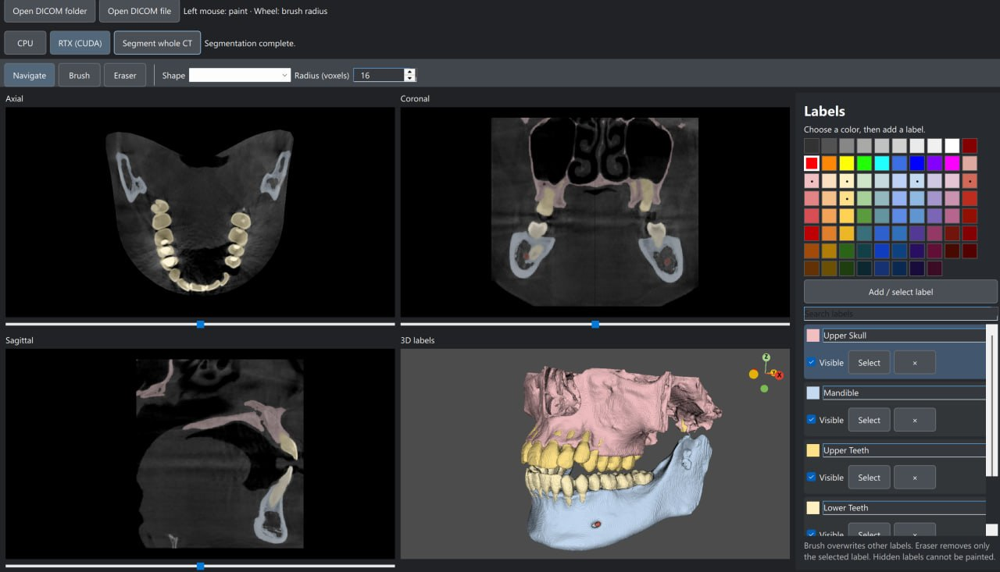
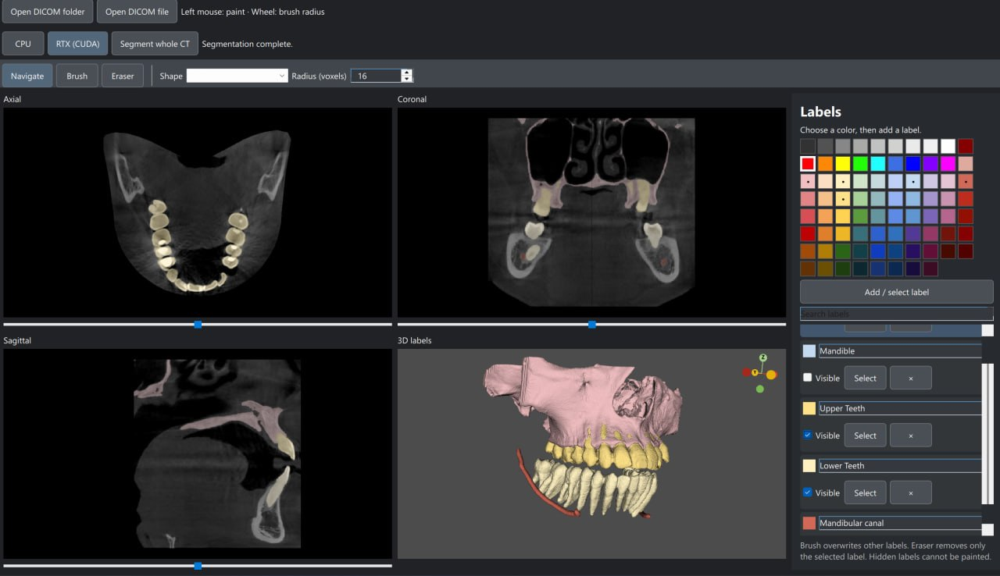

# ct-segmentation — DICOM Viewer and Label Editor

A desktop application for viewing DICOM CT scans and manually segmenting volumes. It displays axial, coronal, and sagittal slices, supports brush-based labeling, and generates 3D surfaces from labels. An optional separate process segments dental anatomy automatically.

Built with C++17, Qt 6/QML, VTK, and ITK.

The DICOM viewer and manual labeling work without model files. **Segment whole CT** requires the optional setup below.

## Screenshots





## Installation

1. Install CMake, a C++17 compiler, and the required libraries: Qt 6 (Core, Quick, Network), VTK, ITK, and Boost 1.85 or newer. The current build targets Windows x64.
2. Clone the repository and run the following commands from its root:

   ```powershell
   cmake -S . -B out/build/x64-Release -DCMAKE_BUILD_TYPE=Release
   cmake --build out/build/x64-Release
   ```

CMake must be able to find the installed libraries. If necessary, provide their locations through `CMAKE_PREFIX_PATH` or package-specific CMake variables. At runtime, the required DLLs must be available on `PATH` or deployed alongside the application.

## Usage

Run `out/build/x64-Release/Segmentation.exe`. Then:

1. Open a DICOM file or a folder containing a scan series.
2. Add a colored label and select the brush or eraser. Brush shapes include Circle, Square, Sphere, Cube, and adaptive 2D/3D brushes.
3. Paint on a slice with the left mouse button. Use the mouse wheel to change the brush radius.

Labels can be renamed, hidden, and deleted. Opening another volume resets the labels. Project saving and segmentation export are not implemented yet.

### Automatic segmentation

The optional `DentalInference.exe` runs DentalSegmentator on CPU or NVIDIA CUDA. To enable CPU inference on a fresh clone:

1. Download the [official DentalSegmentator model](https://github.com/gaudot/SlicerDentalSegmentator/releases/download/v1.0.0-alpha/Dataset111_453CT_v100.zip) and the [ONNX Runtime 1.20.1 Windows x64 CPU package](https://github.com/microsoft/onnxruntime/releases/download/v1.20.1/onnxruntime-win-x64-1.20.1.zip). Extract both archives into `LocalAssets/dental-model/` so the directories match the layout below.
2. Export the model once with Python 3.12:

   ```powershell
   python -m venv out/dental-export-venv
   & out/dental-export-venv/Scripts/python.exe -m pip install -r Tools/dental-export-requirements.txt
   & out/dental-export-venv/Scripts/python.exe Tools/export_dental_model.py `
       LocalAssets/dental-model/Dataset111_453CT/nnUNetTrainer__nnUNetPlans__3d_fullres `
       LocalAssets/dental-model/exported
   ```

3. Configure and build the application:

   ```powershell
   cmake -S . -B out/native-dental `
       -DCMAKE_BUILD_TYPE=Release `
       -DSEGMENTATION_BUILD_DENTAL_INFERENCE=ON
   cmake --build out/native-dental
   ```

The model and runtime binaries are local assets and are not committed to GitHub. Only the DentalSegmentator `Dataset111_453CT` model is supported; arbitrary nnU-Net models are not. Automatically generated labels can be edited manually.

Keep the source assets outside the temporary `out/` directory:

```text
LocalAssets/
├── dental-model/
│   ├── Dataset111_453CT/             # Original model
│   ├── exported/                     # Model files used at runtime
│   ├── onnxruntime-win-x64-1.20.1/   # CPU runtime
│   └── onnxruntime-win-x64-gpu-1.20.1/  # Optional GPU runtime
└── dental-cuda-runtime/              # CUDA and cuDNN files for GPU inference
```

CMake uses the CPU runtime by default. To enable CUDA, set `ONNXRUNTIME_ROOT` to the GPU runtime directory when configuring; `DENTAL_CUDA_RUNTIME_ROOT` defaults to `LocalAssets/dental-cuda-runtime`. `DENTAL_MODEL_DIRECTORY` can override the exported model directory. Each build copies the model to `dental-model/` beside `Segmentation.exe` and the required runtime DLLs beside the executables, including when the executables themselves do not need rebuilding.

## Project structure

- `Gui/Ui/` — QML interface.
- `UI/Adapters/` — bridge between the interface and C++, including the inference job.
- `Backend/` — DICOM loading, slice rendering, labels, and 3D surfaces.
- `Inference/` — separate executable for automatic segmentation.
- `Tests/` — regression tests.
- `Tools/` — model export and validation scripts.

## Data

DICOM scans and model weights are not included. To use the application, provide your own DICOM file or scan series. The application is not intended for clinical use.

## Tests

To build the tests, add `-DSEGMENTATION_BUILD_TESTS=ON` when configuring CMake, then run:

```powershell
cmake --build out/build/x64-Release
ctest --test-dir out/build/x64-Release --output-on-failure
```

## License

The project code is licensed under the [MIT License](LICENSE). Third-party libraries and model files retain their own licenses.
